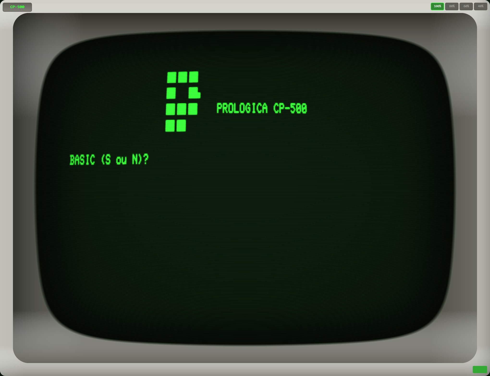

# heh8080

Cross-platform Intel 8080 / Zilog Z80 CPU emulator designed to run LOLOS (a CP/M 2.2 compatible OS) and legacy Z80 software. The desktop app can also emulate the Prológica CP-500.


## Features

- **Dual CPU support**: Intel 8080 and Zilog Z80
- **CP/M compatible I/O**: Console, FDC, MMU, printer, auxiliary, timer
- **Prológica CP-500 machine** (desktop): Brazilian TRS-80 Model III compatible, booted from your own ROM dumps
- **Retro CRT terminal**: Authentic 1970s aesthetic with barrel distortion, bloom, scanlines, and vignette
- **Cross-platform**: Windows, Mac, Linux (NativeAOT), Web (WASM)
- **Responsive scaling**: 100%, 80%, 60%, 40% with platform-aware defaults

## Prológica CP-500



The CP-500 is a Brazilian personal computer that Prológica built in the early 1980s. It is compatible with the TRS-80 Model III. heh8080 emulates the original configuration:

- Zilog Z80 at 2.03 MHz with 48 KB of RAM
- 64 x 16 text screen drawn from the real character generator ROM, including the Portuguese letters, 2 x 3 block graphics and katakana
- WD1791 floppy controller with up to four drives, of which two are installed
- 30 Hz timer interrupt, keyboard matrix, printer port and real-time clock

### ROM files

The CP-500 ROMs are not included. Supply your own dumps, for example from the MAME `cp500` set:

| File | Size | Contents |
|---|---|---|
| `cp500.rom` | 16 KB | System ROM (BASIC and boot code) |
| `cp500-chargen.rom` | 2 KB | Character generator |

Put both files in one of these folders:

- `cp500/` next to the executable
- `cp500/` in the current directory
- `%LOCALAPPDATA%\heh8080\`

When the app finds both files, it starts in the CP-500 at 100% scale. Otherwise it starts in CP/M. Use `--cpm` to start in CP/M anyway. Click the logo in the top-left corner of the bezel to switch machines or mount disks.

### Using the CP-500

- With no disk in drive 0, the machine goes to `BASIC (S ou N)?`. Type `S`, then press Enter at `Cass?` and at `Mem. usada ?` to get the `READY` prompt.
- With a bootable disk in drive 0 (TRS-DOS, DOS-500 and similar), the machine boots from the disk. Disk images can be `.dsk`, `.dmk` or `.jv3`. A disk that the machine writes to is saved back to its file.
- Esc is BREAK, Home is CLEAR, and Backspace is the left arrow, which erases.

## Technology

- .NET 10, Avalonia UI 11.x
- NativeAOT for desktop (19MB native binary)
- WebAssembly for browser
- MIT licensed

## Project Structure

```
src/
  Heh8080.Core/      # Cpu8080, CpuZ80, memory, I/O bus
  Heh8080.Devices/   # FDC, console, MMU, printer, auxiliary, timer
  Heh8080.Terminal/  # FJM-3A terminal emulator
  Heh8080.App/       # Shared UI library: ViewModels, Views, Controls
  Heh8080.Mcp/       # MCP server for AI-assisted development
  Heh8080.Desktop/   # Desktop entry point with Avalonia UI
  Heh8080.Browser/   # Browser entry point with Avalonia WASM
tests/
  Heh8080.Tests/     # Unit and integration tests
  cpu_tests/         # External CPU test suites
```

## Building

```bash
# Desktop (NativeAOT)
dotnet publish src/Heh8080.Desktop -c Release

# Browser (WASM)
dotnet publish src/Heh8080.Browser -c Release
```

## Related Projects

- **LOLOS**: https://github.com/fjzeit/lolos - CP/M 2.2 compatible OS in pure 8080 assembly

## License

MIT
