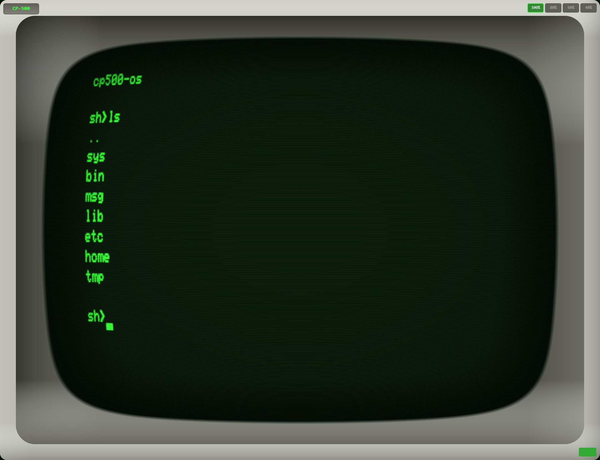
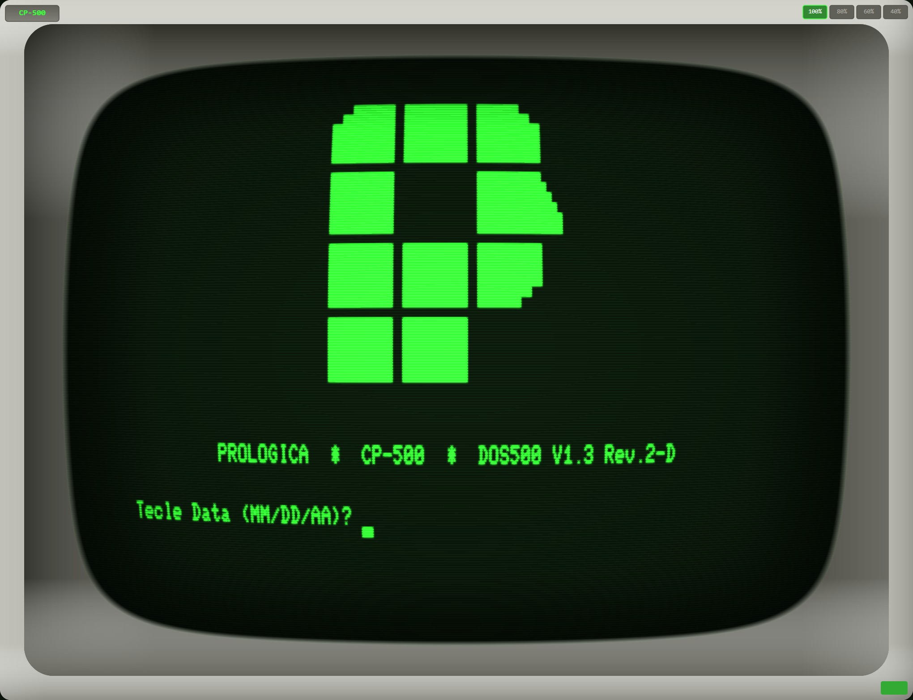

# heh8080 - CP-500

Cross-platform Intel 8080 / Zilog Z80 CPU emulator designed to run LOLOS (a CP/M 2.2 compatible OS) and legacy Z80 software. The desktop app can also emulate the Prológica CP-500.






## Features

- **Dual CPU support**: Intel 8080 and Zilog Z80
- **CP/M compatible I/O**: Console, FDC, MMU, printer, auxiliary, timer
- **Prológica CP-500 machine** (desktop): Brazilian TRS-80 Model III compatible, booted from your own ROM dumps (ROMs not provided, see [ROM files](#rom-files))
- **Retro CRT terminal**: Authentic 1970s aesthetic with barrel distortion, bloom, scanlines, and vignette
- **Cross-platform**: Windows, Mac, Linux (NativeAOT), Web (WASM)
- **Responsive scaling**: 100%, 80%, 60%, 40% with platform-aware defaults

## Prológica CP-500

The CP-500 is a Brazilian personal computer that Prológica built in the early 1980s. It is compatible with the TRS-80 Model III. heh8080 emulates the original configuration:

- Zilog Z80 at 2.03 MHz with 48 KB of RAM
- 64 x 16 text screen drawn from the real character generator ROM, including the Portuguese letters, 2 x 3 block graphics and katakana
- WD1791 floppy controller with up to four drives, of which two are installed
- 30 Hz timer interrupt, keyboard matrix, printer port and real-time clock

### ROM files

> [!IMPORTANT]
> The CP-500 ROMs are not provided with heh8080, and this repository does not contain them. To use the CP-500, you must supply dumps of your own ROMs.

The app needs two ROM files. Rename your dumps to exactly these names, in lowercase:

| File name | Size | Contents |
|---|---|---|
| `cp500.rom` | 16,384 bytes | System ROM (BASIC and boot code) |
| `cp500-chargen.rom` | 2,048 bytes | Character generator |

Put both files in the same folder. The app looks in these folders, in this order:

1. A `cp500` folder next to the executable (`Heh8080.Desktop.exe`, or `Heh8080.Desktop` on Mac and Linux)
2. A `cp500` folder in the current directory, for example the repository root when you run `dotnet run --project src/Heh8080.Desktop`
3. Your local app data folder, `%LOCALAPPDATA%\heh8080\` on Windows (the files go directly in it, without a `cp500` subfolder)

For example, a portable install looks like this:

```
Heh8080.Desktop.exe
cp500/
  cp500.rom
  cp500-chargen.rom
```

The repository's `.gitignore` excludes `cp500/*.rom`, so ROMs you put in `cp500/` at the repository root are never committed.

When the app finds both files, it starts in the CP-500 at 100% scale. If a file is missing or the character generator is not exactly 2,048 bytes, the app starts in CP/M and the CP-500 option stays disabled. Use `--cpm` to start in CP/M anyway. `--disk <path>` mounts that image in CP-500 drive 0 before the machine boots, and writes it back when the disk changes. Click the logo in the top-left corner of the bezel to switch machines, attach RS-232, or mount disks.

### Using the CP-500

- With no disk in drive 0, the machine goes to `BASIC (S ou N)?`. Type `S`, then press Enter at `Cass?` and at `Mem. usada ?` to get the `READY` prompt.
- With a bootable disk in drive 0 (TRS-DOS, DOS-500 and similar), the machine boots from the disk. Disk images can be `.dsk`, `.dmk` or `.jv3`. A disk that the machine writes to is saved back to its file.
- Esc is BREAK, Home is CLEAR, and Backspace is the left arrow, which erases.

### Headless runner

`heh8080-cp500` runs the CP-500 from the command line with no window, for tests and CI. It boots a ROM and up to four disks, runs the steps you give it in order, as fast as your computer allows, and exits with a code you can check. Emulated time counts Z80 cycles only, so every run gives the same result.

```bash
dotnet run --project src/Heh8080.Cp500Runner -- --rom cp500/cp500.rom \
  --until-screen "BASIC (S ou N)" --type 'S\r\r' --until-screen READY \
  --type 'PRINT 2+3\r' --until-screen " 5" --dump-screen
```

- Steps: `--until-screen <text>` waits for text on the screen, `--type <text>` types it (`\r` is Enter, `{BREAK}`, `{CLEAR}` and the arrows are named in braces), `--run <duration>` runs for a while (`500ms`, `30s`, `2m`).
- `--disk0` to `--disk3` mount `.dsk`, `.jv3` or `.dmk` images, and `--write-back` saves modified disks when the run ends. `--timeout` sets how long each wait may take (30 seconds by default).
- `--dump-screen` prints the screen as text, with Portuguese letters, block graphics and katakana as Unicode. `--dump-memory 4300:256` prints a hex dump.
- Exit code 0 means every step succeeded, 1 means a wait timed out (the screen is printed to stderr), and 2 means a usage error or a bad file.

Full contract: [lode/cp500/headless-runner.md](lode/cp500/headless-runner.md).

## Technology

- .NET 10, Avalonia UI 11.x
- NativeAOT for desktop (19MB native binary)
- WebAssembly for browser
- MIT licensed

## Project Structure

```
src/
  Heh8080.Core/      # Cpu8080, CpuZ80, memory, I/O bus
  Heh8080.Devices/   # FDC, console, MMU, printer, auxiliary, timer
  Heh8080.Terminal/  # FJM-3A terminal emulator
  Heh8080.App/       # Shared UI library: ViewModels, Views, Controls
  Heh8080.Mcp/       # MCP server for AI-assisted development
  Heh8080.Cp500Runner/ # heh8080-cp500 headless CP-500 command-line runner
  Heh8080.Desktop/   # Desktop entry point with Avalonia UI
  Heh8080.Browser/   # Browser entry point with Avalonia WASM
tests/
  Heh8080.Tests/     # Unit and integration tests
  cpu_tests/         # External CPU test suites
```

## Building

```bash
# Desktop (NativeAOT)
dotnet publish src/Heh8080.Desktop -c Release

# Browser (WASM)
dotnet publish src/Heh8080.Browser -c Release

# CP-500 headless runner (NativeAOT)
dotnet publish src/Heh8080.Cp500Runner -c Release
```

## Related Projects

- **LOLOS**: https://github.com/fjzeit/lolos - CP/M 2.2 compatible OS in pure 8080 assembly

## License

MIT
