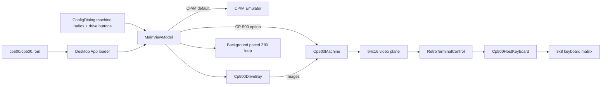

# CP-500 Desktop Integration

The net10.0 Avalonia desktop app starts in the unchanged CP/M machine and
offers CP-500 as a second machine in `ConfigDialog`; `--cp500` starts directly
in it. At startup, `App` looks for the user-owned `cp500.rom` in
`<app dir>/cp500/`, `<current dir>/cp500/` and `%LOCALAPPDATA%\heh8080\`. The
file is read into memory and passed to `MainViewModel`; it is never an Avalonia
resource or embedded resource. CP-500 selection is disabled when no ROM is
found. The bundled LOLOS disk is mounted on A: in both start modes, so
switching back to CP/M boots it.

```csharp
var viewModel = new MainViewModel(diskProvider, LoadCp500Rom());
await viewModel.SwitchMachine(EmulatedMachine.Cp500);
await viewModel.SwitchMachine(EmulatedMachine.Cpm);
```



## Display and input contracts

- `RetroTerminalControl` retains its housing, phosphor palette, CRT shader,
  scale controls, drag behavior, configuration logo, and exit button.
- CP-500 mode renders exactly 64 columns by 16 rows. Zero is a blank video
  cell; other bytes below `20h` use the Model III `@`-based codes, and bytes
  with bit 7 set are 2-by-3 semigraphics.
- Keys go through `Cp500KeyMap` and `Cp500HostKeyboard` (Devices). A host key
  holds its matrix switch exactly while it is down; auto-repeat of a held host
  key is ignored so the ROM does its own repeat. Letters come from the physical
  key (Caps Lock and Ctrl do not change which switch closes); punctuation
  states the SHIFT it needs on the TRS-80. Enter, Space, Backspace (LEFT, which
  erases), Escape (BREAK), Home (CLEAR) and the arrows map to row 6. Focus loss
  releases the whole matrix.
- The keyboard port combines selected active-high rows with bitwise OR and
  returns 00h when no key in the selected rows is pressed.
- CP-500 uses the original 48 KiB, 2.03 MHz profile with two installed drives.
  CPU selection remains a CP/M-only option.
- The host never pauses the CPU at boot prompts. With empty drives the ROM
  itself loops on `Diskette?` (see [summary.md](summary.md)); BREAK does not
  leave it, a mounted bootable disk does.

## Disk mounting

The drive rows of `ConfigDialog` serve the active machine and keep the CP/M
look: a number prefix, a name label, Mount and Unmount buttons.

- CP-500 shows drives `0:`-`3:`. Drives beyond the profile's installed count
  read `(no drive)`; empty ones read `(empty)`; otherwise the file name shows.
  The labels refresh when the machine is switched.
- Mount opens a file picker for `.dsk`, `.dmk`, `.jv3`. A `.dsk` is raw when
  exactly 184,320 or 368,640 bytes and JV3 otherwise
  (`ModelIIIDiskCodec.DetectKind`). Mounting does not reboot the machine; the
  ROM notices the disk on its next retry.
- `MainViewModel` owns a `Cp500DriveBay` and passes its provider to the
  machine. `MountCp500Disk` and unmount stop the run loop, change the bay, and
  restart the loop, so the CPU never races a mount. Errors (bad image, IO) show
  in `StatusText` and leave the drive as it was.
- Persistence policy: a disk that was written to is saved back to its own file
  in its source format when it is unmounted, replaced, the machine is switched
  to CP/M, or the app shuts down. Read-only files (file attribute) mount write
  protected and are never saved. Unmodified disks are never rewritten. The
  Desktop write-back writes a temp file and renames it over the original, and a
  failed save keeps the disk mounted and shows the error.
- File IO stays in the Desktop project (`ConfigDialog`); the view model only
  takes bytes and a write-back delegate, so Browser can supply its own storage
  and still compiles against the same view model.

## Execution and lifecycle contracts

`MainViewModel` owns one cancellable CP-500 task. Each batch runs at least 2,048
Z80 cycles with `Cp500Machine.Step`, then consumes `LastSuggestedDelay`, or
yields, without blocking Avalonia. The machine advances the 30 Hz timer and
disk controller itself. Switching machines, resetting, mounting and unmounting
first cancel and await the active loop.

```csharp
for (int cycles = 0; cycles < 2048;)
    cycles += machine.Step();

if (machine.LastSuggestedDelay >= TimeSpan.FromMilliseconds(1))
    await Task.Delay(machine.LastSuggestedDelay, cancellationToken);
```

## Rationale and lessons

Keeping file lookup in Desktop preserves browser compatibility and keeps ROM
bytes outside build artifacts. Reusing the CRT control avoids another
window/input shell while Devices remains the sole owner of video and keyboard
state. CP/M reboots from mounted drive A: when selected again rather than
sharing CPU/device state. Holding keys instead of pulsing them lets the ROM see
real key state; the earlier fixed-length pulses were a workaround for a wrong
keyboard polarity and port map.

Related: [summary.md](summary.md), [devices.md](devices.md),
[../ui/desktop-app.md](../ui/desktop-app.md),
[../plans/cp500-emulation.md](../plans/cp500-emulation.md).
