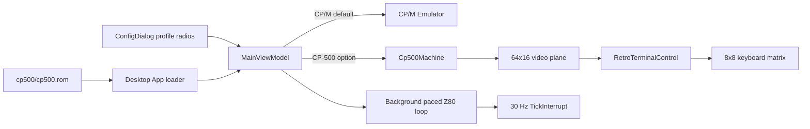

# CP-500 Desktop Integration

The net10.0 Avalonia desktop app starts in the unchanged CP/M profile and offers
CP-500 as a second machine in `ConfigDialog`. At startup, `App` searches upward
from both the current directory and executable directory for the user-owned
`cp500/cp500.rom`. The file is read into memory and passed to
`MainViewModel`; it is never an Avalonia resource or embedded resource. CP-500
selection is disabled when no ROM is found.

```csharp
var viewModel = new MainViewModel(diskProvider, LoadCp500Rom());
await viewModel.SwitchMachineProfile(DesktopMachineProfile.Cp500);
await viewModel.SwitchMachineProfile(DesktopMachineProfile.Cpm);
```



## Display and input contracts

- `RetroTerminalControl` retains its housing, phosphor palette, CRT shader,
  scale controls, drag behavior, configuration logo, and exit button.
- CP-500 mode renders exactly 64 columns by 16 rows. Zero is a blank video
  cell; other bytes below `20h` use the Model III `@`-based codes, and bytes
  with bit 7 set are 2-by-3 semigraphics.
- Avalonia text input maps letters, digits, space, and punctuation to the
  active-high matrix. Printable keys pulse for 50 ms and are serialized so
  successive text-input events cannot overlap in the matrix. Enter,
  Clear/Backspace, Break/Escape, and arrows use the same 50 ms serialized
  pulse, preventing host key-repeat from becoming repeated firmware input.
  Focus loss releases the whole matrix.
- CP-500 uses the original 48 KiB, 2.03 MHz profile. CPU selection remains a
  CP/M-only option.
- The host never pauses the CPU at boot prompts. The ROM idles at
  `BASIC (S ou N)?` on its own; an earlier "boot gate" that paused at prompts
  only hid phantom keys caused by the wrong keyboard polarity and port map.
- Printable host keys are serialized as 50 ms matrix pulses. Desktop
  scheduling can delay CP-500 matrix scans beyond the nominal 30 Hz cadence,
  so this duration ensures the firmware observes every host text-input event
  without turning a held key into repeated scans.
- The keyboard port combines selected active-high rows with bitwise OR and
  returns 00h when no key in the selected rows is pressed.
- The run loop advances bounded 2,048-cycle batches. This
  keeps the ROM at its intended 2.03 MHz rate without replacing the throttle
  with host scheduler overhead.
- Desktop writes up to 10,000 sequence-numbered CP-500 diagnostic records to
  `%LOCALAPPDATA%\heh8080\cp500-diagnostics.log` per launch. The trace records
  host key mapping, matrix state changes, all row selections while a key is
  held, and non-zero reads otherwise; it
  is reset at startup and is intended for ROM/input investigation rather than
  normal telemetry.

## Execution and lifecycle contracts

`MainViewModel` owns one cancellable CP-500 task. It batches at least 2,048 Z80
cycles, consumes `LastSuggestedDelay`, and yields or delays without blocking
Avalonia. The same loop advances the interrupt latch at 30 Hz. Switching
profiles or resetting first cancels and awaits the active loop.

```csharp
for (int cycles = 0; cycles < 2048;)
    cycles += machine.Step();

if (machine.LastSuggestedDelay >= TimeSpan.FromMilliseconds(1))
    await Task.Delay(machine.LastSuggestedDelay, cancellationToken);
machine.TickInterrupt(); // scheduled by a 30 Hz Stopwatch deadline
```

## Rationale and lessons

Keeping file lookup in Desktop preserves browser compatibility and keeps ROM
bytes outside build artifacts. Reusing the CRT control avoids another
window/input shell while Devices remains the sole owner of video and keyboard
state. CP/M reboots from mounted drive A: when selected again rather than
sharing CPU/device state.

Related: [summary.md](summary.md), [devices.md](devices.md),
[../ui/desktop-app.md](../ui/desktop-app.md),
[../plans/cp500-emulation.md](../plans/cp500-emulation.md).
