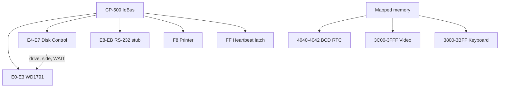

# CP-500 Devices

CP-500 peripherals are reusable `IIoDevice` or `IMemoryRegion` implementations
in `Heh8080.Devices`. They register only CP-500 ports and do not alter the
existing CP/M port map or `FloppyDiskController`.

```csharp
var images = new MemoryModelIIIDiskImageProvider();
images.MountBlank(0);
var fdc = new Wd1791Controller(images);
var diskControl = new Cp500DiskControlDevice(fdc);
fdc.Register(bus);                         // E0h-E3h (F0h-F3h compatibility aliases)
diskControl.Register(bus);                 // E4h-E7h (F4h-F7h compatibility aliases)
bus.Out(Cp500DiskControlDevice.ControlPort, 0x01); // Drive 0, side 0
bus.Out(Wd1791Controller.CommandStatusPort, 0x80); // Read sector

interrupts.SetInterruptCallback(() => cpu.Interrupt(0xFF));
interrupts.Tick();                         // Host calls at 30 or 80 Hz
```



## Contracts and invariants

- `Wd1791Controller` is at `E0h-E3h` (command/status, track, sector, data).
  `F0h-F3h` remains registered as a compatibility alias.
  It transfers 256-byte sectors and keeps the physical head track distinct from
  its visible track register. `STEP`, `STEP IN`, and `STEP OUT` change the
  register only with command bit `10h`/U; `SEEK` and `RESTORE` synchronize both.
- Default `MemoryModelIIIDiskImageProvider` media is 180 KiB: 40 tracks, one
  side, 18 one-based sectors per track, and 256 bytes per sector. A host must
  explicitly pass `ModelIIIDiskFormat.DoubleSided` for a 360 KiB two-sided
  image, so a default image can never be misaddressed through side 1.
- `Cp500DiskControlDevice` mirrors its latch at `E4h-E7h` (with `F4h-F7h` compatibility
  aliases): bits `0-3` select
  drive lines, bit `4` selects side, and bit `6` requests WAIT. It exposes
  DRQ, INTRQ, `WaitActive`, and change events to hosts without imposing CPU
  WAIT/NMI plumbing on Core. No drive line is selected after machine reset.
- `IModelIIIDiskImageProvider` leaves files, browser persistence, DMK/JV1/JV3
  parsing, and drive selection UI to its host. The included memory provider
  defensively pads short media with `E5h` in the explicitly selected format.
- `Cp500InterruptDevice` is a 30/80 Hz status/control latch at `FFh`.
  `Tick` invokes its callback only while enabled; an `IN FFh` acknowledges it.
- `Cp500RtcDevice` stores a software offset over an injected `TimeProvider` and
  exposes BCD seconds, minutes, and hours. `Cp500PrinterPort` is an `F8h`
  output/status adapter; `Cp500Rs232Device` is a safe ready/data stub.

## Rationale and lessons

The current slice models the hardware contracts needed for ROM bring-up and
disk I/O without claiming a UI renderer, host key map, cassette transport, or
disk-file codec. Those boundaries can evolve per platform without affecting
CPU, memory, or CP/M compatibility.

Related: [summary.md](summary.md), [memory-map.md](memory-map.md),
[../devices/devices.md](../devices/devices.md),
[../devices/io-ports.md](../devices/io-ports.md).
