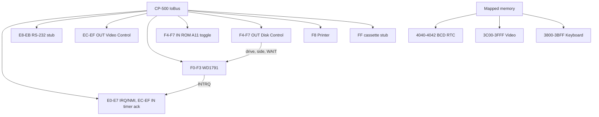

# CP-500 Devices

CP-500 peripherals are reusable `IIoDevice` or `IMemoryRegion` implementations
in `Heh8080.Devices`. They register only CP-500 ports and do not alter the
existing CP/M port map or `FloppyDiskController`.

```csharp
var images = new MemoryModelIIIDiskImageProvider();
images.MountBlank(0);
var fdc = new Wd1791Controller(images);
var diskControl = new Cp500DiskControlDevice(fdc);
fdc.Register(bus);                         // F0h-F3h
diskControl.Register(bus);                 // F4h-F7h writes only
bus.Out(Cp500DiskControlDevice.ControlPort, 0x01); // Drive 0, side 0
bus.Out(Wd1791Controller.CommandStatusPort, 0x80); // Read sector

interrupts.SetInterruptCallback(() => cpu.Interrupt(0xFF));
interrupts.SetNmiCallback(cpu.NonMaskableInterrupt);
fdc.InterruptRequestChanged += interrupts.SetFdcInterruptRequest;
interrupts.AdvanceCycles(profile.ClockHz / 30); // Cycle-driven timer tick.
```



## Contracts and invariants

- `Wd1791Controller` is at `F0h-F3h` (command/status, track, sector, data),
  with no aliases. It supports immediate
  compatibility timing by default and non-zero `Wd1791Timing` for cycle-driven
  command delay, DRQ byte windows, lost-data deadlines, and elapsed-cycle
  accounting through `AdvanceCycles`.
- WD1791 commands include restore, seek/step, read/write sector, force
  interrupt, read address, read track, and write track. Status exposes busy,
  DRQ, lost data, CRC, record-not-found, write-protect, and not-ready bits.
  INTRQ is an FDC line routed to `Cp500InterruptDevice`; hosts must not wire it
  straight to the CPU.
- Default `MemoryModelIIIDiskImageProvider` media is 180 KiB: 40 tracks, one
  side, 18 one-based sectors per track, and 256 bytes per sector. A host must
  explicitly pass `ModelIIIDiskFormat.DoubleSided` for a 360 KiB two-sided
  image, so a default image can never be misaddressed through side 1.
- `Cp500DiskControlDevice` owns `F4h-F7h` writes: bits `0-3` select drive
  lines, bit `4` selects side, and bit `6` requests CPU WAIT. The latch is
  write-only. `F4h-F7h` reads are owned by `Cp500SystemRom` and toggle the
  CP-500 ROM A11 flip-flop, returning 00h.
- `IModelIIIDiskImageProvider` is host-independent but native-sector aware:
  metadata contains track/side/ID, density, deleted-data marker, and CRC
  validity. `ModelIIIDiskCodec` parses and serializes raw, JV1, JV3, and DMK
  containers; the memory provider mounts either raw bytes or decoded native
  images.
- `Cp500InterruptDevice` owns `E0h-E7h` and `ECh-EFh` reads: E0 reads the
  active-low masked IRQ sources, E4 reads the active-low masked NMI sources and
  clears them, and EC acknowledges the timer IRQ. A timer tick latches only
  when the E0 mask enables bit 2, and stays latched until EC is read. FDC INTRQ
  and reset NMI are maskable NMI sources. Cassette source bits are accepted in
  masks but never asserted. `Cp500CassettePort` answers `FFh` with 00h.
- `Cp500VideoDevice` owns `ECh-EFh` writes (non-cassette video control). Bit 2 selects
  32-column fallback rendering, bit 3 selects the alternate character set, and
  bit 7 forces inverse fallback rendering. Mode changes do not mutate VRAM.
- `Cp500RtcDevice` stores a software offset over an injected `TimeProvider` and
  exposes BCD seconds, minutes, and hours. `Cp500PrinterPort` is an `F8h`
  output/status adapter; `Cp500Rs232Device` is a safe ready/data stub.

## Rationale and lessons

The current slice models the hardware contracts needed for ROM bring-up and
disk I/O without claiming a UI renderer, host key map, cassette transport, or
disk-file codec. Those boundaries can evolve per platform without affecting
CPU, memory, or CP/M compatibility.

Related: [summary.md](summary.md), [memory-map.md](memory-map.md),
[../devices/devices.md](../devices/devices.md),
[../devices/io-ports.md](../devices/io-ports.md).
