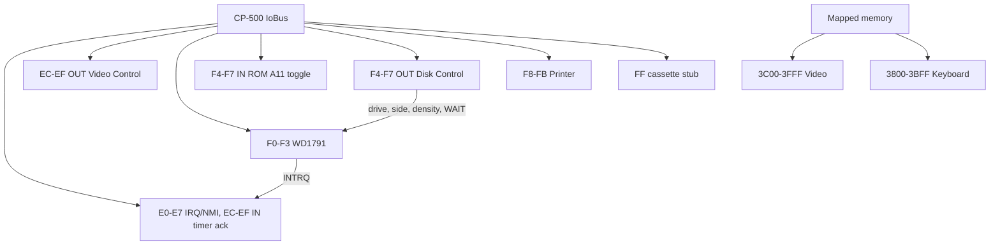

# CP-500 Devices

CP-500 peripherals are reusable `IIoDevice` or `IMemoryRegion` implementations
in `Heh8080.Devices`. They register only CP-500 ports and do not alter the
existing CP/M port map or `FloppyDiskController`.

```csharp
var images = new MemoryModelIIIDiskImageProvider();
images.MountBlank(0);
var fdc = new Wd1791Controller(images, installedDrives: 2);
var diskControl = new Cp500DiskControlDevice(fdc);
var interrupts = new Cp500InterruptDevice(profile.ClockHz);
fdc.Register(bus);                         // F0h-F3h
diskControl.Register(bus);                 // F4h-F7h writes only
interrupts.Register(bus);                  // E0h-E7h, ECh-EFh reads
bus.Out(Cp500DiskControlDevice.ControlPort, 0x01); // Drive 0, side 0
bus.Out(Wd1791Controller.CommandStatusPort, 0x80); // Read sector

interrupts.InterruptLineChanged += asserted => cpu.SetInterruptLine(asserted);
interrupts.NonMaskableInterruptRaised += cpu.NonMaskableInterrupt;
fdc.InterruptRequestChanged += interrupts.SetFdcInterruptRequest;
interrupts.AdvanceCycles(cycles); // Cycle-driven 30 Hz timer; Cp500Machine.Step does this.
```



## Contracts and invariants

- `Wd1791Controller` is at `F0h-F3h` (command/status, track, sector, data),
  with no aliases. It uses immediate compatibility timing by default and a
  non-zero `Wd1791Timing` for cycle-driven command delay, DRQ byte windows,
  lost-data deadlines, and the rotating index pulse (300 RPM) through
  `AdvanceCycles`.
- WD1791 commands include restore, seek/step, read/write sector, force
  interrupt, read address, read track, and write track. Status exposes busy,
  DRQ, lost data, CRC, record-not-found, write-protect, and not-ready bits.
  INTRQ is an FDC line routed to `Cp500InterruptDevice`; hosts must not wire it
  straight to the CPU.
- Installed drives: the controller is built with the profile's installed drive
  count. A selected installed drive reports TR00 whenever its head is at track
  0, with or without media. Ready and the index pulse need media. An
  uninstalled or unselected drive is not ready and never reports TR00. The ROM
  relies on this split, see the boot flow in [summary.md](summary.md).
- `IModelIIIDiskImageProvider` is host-independent and native-sector aware:
  `IsMounted`, `IsReadOnly`, `GetTrack` (sector metadata: track, side, ID,
  density, deleted-data marker, CRC validity), `WriteSector` (with the
  deleted-data flag) and `ReplaceTrack` (write track). Up to
  `ModelIIIDiskGeometry.MaxDrives` (4) drives, 40 tracks, 18 one-based 256-byte
  sectors per track; 180 KiB single sided, 360 KiB double sided.
- `ModelIIIDiskCodec` parses and serializes three containers: raw
  (exactly 184,320 or 368,640 bytes), JV3 and DMK. A JV1 file is the same bytes as a raw 180 KiB image.
  `DetectKind(fileName, length)` picks the container of a host file: `.dmk` is
  DMK, `.jv3` is JV3, any other name is raw at an exact raw size and JV3
  otherwise. Helpers: `Jv3Format`, `DmkFormat`, `ModelIIITrackFormat`,
  `ModelIIIDiskCrc`.
- `MemoryModelIIIDiskImageProvider` mounts parsed images, tracks which drives
  were written (`IsModified`, `MarkSaved`) and serializes a drive back in its
  source container (`GetImageBytes`).
- `Cp500DriveBay` is the host side of the drives: it owns a
  `MemoryModelIIIDiskImageProvider` (`Images`, passed to `Cp500Machine`), a
  display name per drive and the persistence policy. `Insert` validates the
  image first (an invalid file leaves the drive untouched), writes back the
  previous disk, then mounts. `Eject` and `Flush` write back too. A disk is
  written back, in its source format, only when it was modified, is writable and
  was inserted with a write-back callback. A failing write-back throws and the
  disk stays mounted and modified. The bay owns no file IO and is not thread
  safe: the host must not use it while the CPU runs.
- `Cp500DiskControlDevice` owns `F4h-F7h` writes: bits `0-3` select drive
  lines, bit `4` selects side, bit `6` requests CPU WAIT and bit `7` selects
  MFM density. The latch is write-only. `F4h-F7h` reads are owned by
  `Cp500SystemRom` and toggle the A11 flip-flop, returning 00h.
- `Cp500InterruptDevice` owns `E0h-E7h` and `ECh-EFh` reads: E0 reads the
  active-low masked IRQ sources, E4 reads the active-low masked NMI sources,
  and EC acknowledges the timer IRQ. The IRQ line is a level
  (`InterruptLineChanged`): it follows `mask & pending` and stays high until
  EC is read. A timer tick latches only when the E0 mask enables bit 2. NMI is
  an edge (`NonMaskableInterruptRaised`) raised when an enabled source becomes
  active. FDC INTRQ is the only NMI source (E4 bit 7) and its status bit
  mirrors the live line. The 30 Hz timer is driven by `AdvanceCycles` from the
  CPU clock. Cassette and RS-232 sources are not modelled.
  `Cp500CassettePort` answers `FFh` with 00h and discards writes.
- `Cp500VideoDevice` owns `ECh-EFh` writes (non-cassette video control). Bit 2
  selects 32-column rendering and bit 3 selects the alternate (katakana)
  character set for `C0h-FFh`. Mode changes do not mutate VRAM.
- `Cp500CharacterGenerator` wraps the 2 KiB character ROM (256 glyphs of 8
  bytes, bit 7 leftmost; 00-1F Portuguese letters, 20-7F ASCII, 80-BF special
  symbols, C0-FF katakana) and rejects any other size. `Cp500Raster.Render`
  turns a VRAM snapshot plus the ECh value into a 512 by 192 one-byte-per-pixel
  frame; `Cp500VideoDevice.Render` is the convenience wrapper. Both are free
  of UI types. Mapping and rendering: [desktop-integration.md](desktop-integration.md).
- `Cp500PrinterPort` is an `F8h-FBh` adapter: output goes to an optional
  `IPrinterDevice`, status reads ready (select, no fault) unless the printer
  reports busy.
- Host keyboard input: `Cp500KeyMap` maps host keys and characters to matrix
  switches plus the SHIFT state they need. `Cp500HostKeyboard` holds a switch for
  exactly as long as the host key is down (no pulses, so the ROM sees real key
  state and auto-repeats), ignores host auto-repeat, and releases everything on
  focus loss. The ROM has no key for `\`, `]`, `^` or `_`, so they are not
  mapped; the UP arrow produces `[`. Backspace is the LEFT arrow, which erases.

## Rationale and lessons

The model covers the hardware contracts needed for ROM bring-up and disk I/O
without claiming a cassette transport, RS-232 or a real-time clock. The host
boundary stays narrow: bytes in, a write-back callback out. Platform code
supplies file IO while the drive logic and persistence policy are unit-tested
in Devices.

Related: [summary.md](summary.md), [memory-map.md](memory-map.md),
[desktop-integration.md](desktop-integration.md),
[../devices/devices.md](../devices/devices.md),
[../devices/io-ports.md](../devices/io-ports.md).
