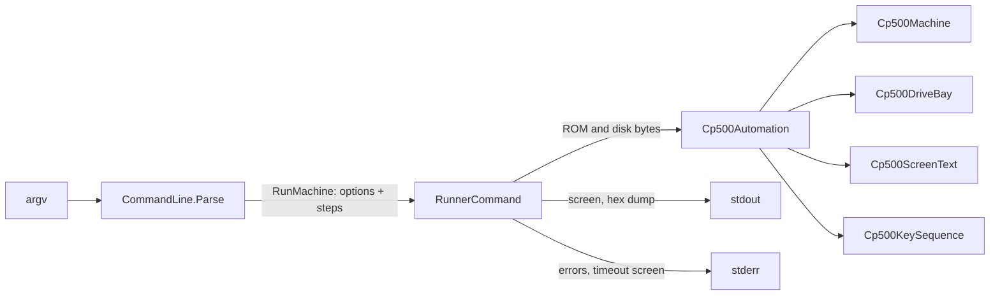

# CP-500 Headless Runner

`heh8080-cp500` (`src/Heh8080.Cp500Runner`) boots a `Cp500Machine` from the
command line, runs a script of steps as fast as the host allows and exits with
a code CI can check. It exists so the cp500-os repository can boot its disk
images in tests. The machine operations live in `Cp500Automation`
(`src/Heh8080.Devices`); the executable only parses arguments, reads and
writes files and prints.

```text
heh8080-cp500 --rom stub.rom --disk0 build/boot.dsk --until-screen "ok" \
  --type "ls /bin\r" --until-screen "bin" --timeout 30s --dump-screen
```

```csharp
var drives = new Cp500DriveBay();
drives.Insert(0, File.ReadAllBytes("boot.dsk"), "boot.dsk", writeBack: null);
var automation = new Cp500Automation(File.ReadAllBytes("cp500.rom"), drives);

bool ready = automation.RunUntilScreenContains("READY", TimeSpan.FromSeconds(30));
automation.Type(@"PRINT 2+3\r");
automation.Run(TimeSpan.FromSeconds(1));
string screen = automation.ReadScreenText();
byte[] bootSector = automation.ReadMemory(0x4300, 256);
```



## Command-line contract

| Option | Meaning |
|---|---|
| `--rom <path>` | System ROM image. Required. |
| `--disk0` .. `--disk3 <path>` | Disk image; raw, JV3 or DMK by `ModelIIIDiskCodec.DetectKind`. A file with the read-only attribute mounts write protected. |
| `--write-back` | At exit, save modified disks to their files in their source format (temp file, then rename). Without it, writes stay in memory. |
| `--timeout <duration>` | Emulated time each `--until-screen` may take. Default 30s. Given once. |
| `--dump-screen` | At exit, print the screen to stdout. |
| `--dump-memory <hex>:<len>` | At exit, print `<len>` (decimal) bytes from `<hex>` (optional `0x` or `h`), 16 per line as `4300: 42 4F ...`. Repeatable; never past FFFFh. |
| `--until-screen <text>` | Step: run until the text appears within one screen row. |
| `--type <text>` | Step: type through the keyboard matrix. |
| `--run <duration>` | Step: run for that much emulated time. |
| `--help` | Print usage, exit 0. |

- Steps run in command-line order; options can sit anywhere. Durations are a
  positive number with `ms`, `s` or `m` (`500ms`, `30s`, `1.5s`, `2m`), at
  most a day.
- Exit codes: `0` every step succeeded; `1` an `--until-screen` timed out
  (stderr names the step, its text and the emulated time, then prints the
  screen; later steps do not run); `2` usage error, missing or unreadable
  file, empty ROM or invalid disk image (one line on stderr), or a failed
  write-back.
- After the steps, success or timeout, modified disks are written back (with
  `--write-back`), then `--dump-screen` and each `--dump-memory` print in that
  order. Output is UTF-8 with `\n` line ends on every OS.

### Typing

- Characters go through `Cp500KeyMap` with the SHIFT a desktop user would
  send: an upper-case letter is SHIFT plus the letter, a lower-case letter is
  the letter alone (the stock ROM shows both upper case), punctuation takes
  the SHIFT the TRS-80 needs (`"` is SHIFT 2, `+` is SHIFT `;`).
- `\r` or a real carriage return is ENTER. `\\` is a backslash, which no
  CP-500 key types, so it is rejected like `^`, `_`, `]` or a line feed.
  Braces name keys without a character, in any letter case: `{ENTER}`,
  `{CLEAR}`, `{BREAK}`, `{UP}`, `{DOWN}`, `{LEFT}`, `{RIGHT}`, `{SPACE}`.
  Any other escape or name is a usage error, checked before the run starts.
- Each key is held `Cp500Automation.KeyHoldDuration` (100 ms) and followed by
  `KeyGapDuration` (100 ms) with every typed key up. Measured against the stock
  ROM at the BASIC prompt: holds of 20 ms or less are missed, 25 ms is
  reliable, auto-repeat starts between 0.7 s and 1 s, and a 5 ms gap is
  enough even for a repeated key. 100 ms spans three 30 Hz ticks, so a driver
  that debounces over two consecutive 33 ms scans (cp500-os) sees both the
  press and the release.

## Machine contract (`Cp500Automation`)

- Built from ROM bytes, an optional `Cp500DriveBay` and an optional profile
  (default `Original`: 48 KiB, two drives). Like the desktop, it starts with
  `ResetHoldingBreak` when drives are installed and drive 0 is empty, so the
  stock ROM offers `BASIC (S ou N)?` instead of looping on `Diskette?`; with
  a disk in drive 0 it boots from the disk.
- Time is executed Z80 cycles only. `LastSuggestedDelay` is ignored, so runs
  are deterministic and unthrottled. Run targets advance on an exact schedule
  (`duration x ClockHz`); the few cycles an instruction ends past a target do
  not add up across steps.
- `RunUntilScreenContains` checks before running and then every
  `ScreenCheckInterval` (1/30 s), and returns false at the timeout. Text
  already on screen satisfies it at once, so a script should wait for output
  the command produces rather than a prompt that is still visible from before.
  Text is matched within a row, never across rows.
- Screen text is `Cp500ScreenText`, the Unicode reading of what
  `Cp500Raster` draws: `00h-1Fh` the character generator's European letters,
  `20h-7Fh` ASCII (`7Ch` is the broken bar `¦`, `7Fh` is `±`), `80h-BFh`
  block graphics as Unicode sextants (`U+1FB00` block, plus `▌ ▐ █`),
  `C0h-FFh` the special symbols or, with ECh bit 3 (the stock ROM's setting),
  half-width katakana (`C0h` is `¥`). Glyphs with no Unicode counterpart read
  as `U+FFFD`. In 32-column mode only the even columns are read. Printed rows
  have trailing spaces trimmed; `ReadScreenRows` keeps them.
- `ReadMemory` reads what the CPU sees (ROM, keyboard, VRAM, RAM, open bus
  FFh) and never wraps past FFFFh.

## Speed

Stock ROM, no disks (BREAK held into the BASIC prompt), `--run 120s` on the
development machine: about 110 emulated seconds per wall second with the
NativeAOT build (1.07 s wall) and about the same with the JIT build once warm.
Reaching `BASIC (S ou N)?` takes about 20 ms wall, most of it process startup.

## Rationale and lessons

`Cp500Automation` lives in Devices, not in the runner, because `Heh8080.Mcp`
already references Devices and cannot sensibly reference an executable; the
MCP tools for the CP-500 can then expose the same boot, type, wait, read
screen and read memory operations without a second implementation. It owns no
file IO, so it stays usable from the Browser target too. The command line is
parsed once into typed records (`UntilScreenStep`, `TypeStep`, `RunStep`,
`MemoryRange`), so typing syntax, durations and dump ranges are rejected
before the machine starts and the executor trusts its inputs.

Screen conditions are polled once per frame because a 30 Hz scanning program
cannot change the screen meaningfully faster; checking after every
instruction would cost far more than emulating. The text mapping was read off
the character generator glyphs rather than assumed ASCII, so a test can
assert on exactly what a user sees on the desktop.

Related: [summary.md](summary.md), [devices.md](devices.md),
[desktop-integration.md](desktop-integration.md),
[../mcp/mcp-server.md](../mcp/mcp-server.md).
