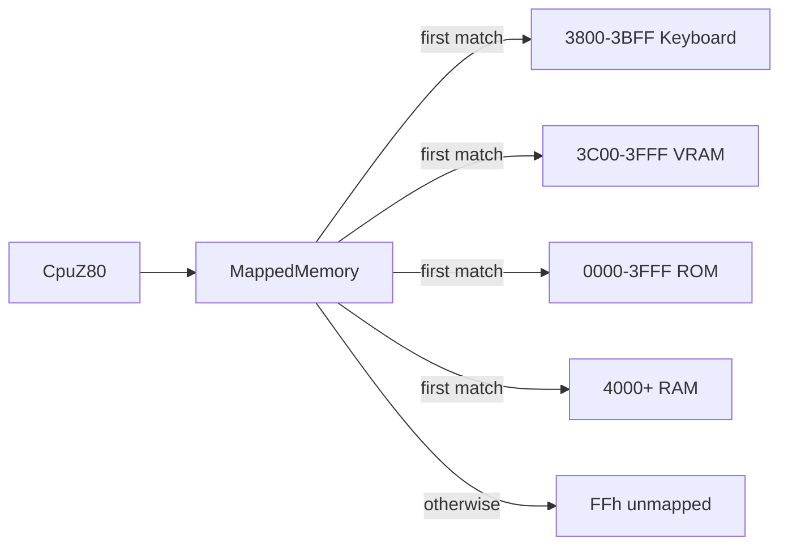

# CP-500 Mapped Memory

`MappedMemory` in Core dispatches the first matching `IMemoryRegion`, so region
order is hardware priority. `Cp500Machine` puts keyboard and video ahead of the
ROM and RAM. Addresses nobody handles read as `FFh` and ignore writes, which is
the deterministic open-bus behavior above installed RAM. This is separate from
the legacy banked `Memory` class, which remains the CP/M implementation.

```csharp
var memory = new MappedMemory(
    new KeyboardMatrixRegion(0x3800, 0x400, matrix), // active-high selected rows
    video.VideoRam,                                  // 3C00h-3FFFh, events only on changed cells
    rom,                                             // Cp500SystemRom, 0000h-3FFFh; writes ignored
    new RamMemoryRegion(0x4000, profile.RamSizeBytes));
```



## Contracts and invariants

- All regions fit one non-wrapping 64 KiB address range. A 256-entry page table
  caches the owner of every 256-byte page a single region owns entirely; pages
  shared by several regions are resolved per address. A region whose answers
  change at runtime implements `IRemappableMemoryRegion` and raises
  `MappingChanged` so the table refreshes.
- `Cp500SystemRom` copies the image (padding to 16 KiB with FFh) and ignores
  writes. Each read of F4h-F7h toggles an internal A11 flip-flop; while set, a
  ROM read at `a` returns EPROM byte `a | 0800h`, so 3000h-37FFh shows the
  monitor code at EPROM 3800h-3FFFh. Keyboard and video regions stay before
  the ROM in the map, so they win in both A11 states. Reset clears the
  flip-flop. The ROM is always visible; there is no overlay switch.
- RAM is 16, 32 or 48 KiB from `4000h`. The space above installed RAM reads as
  open bus.
- `VideoRamRegion.Changed` fires after a value actually changes, avoiding
  redundant host redraws.
- `KeyboardMatrix` is 8-by-8 and active high (MAME `keyboard_r`). Address
  low-byte bits select rows; a pressed switch reads as a 1 bit and an idle row
  reads 00h. Selected rows are combined with bitwise OR, so a zero row mask
  reads 00h and multi-row selection reports every pressed key bit.

## Rationale and lessons

The 16 KiB ROM socket overlaps the hardware keyboard/video addresses; priority
routing models that overlay directly. This supersedes the earlier planning
assumption of a fixed 12 KiB ROM range: the copied CP-500 ROM image is 16 KiB,
while the keyboard and VRAM still win at their physical addresses.

Related: [summary.md](summary.md), [devices.md](devices.md),
[../core/z80.md](../core/z80.md).
