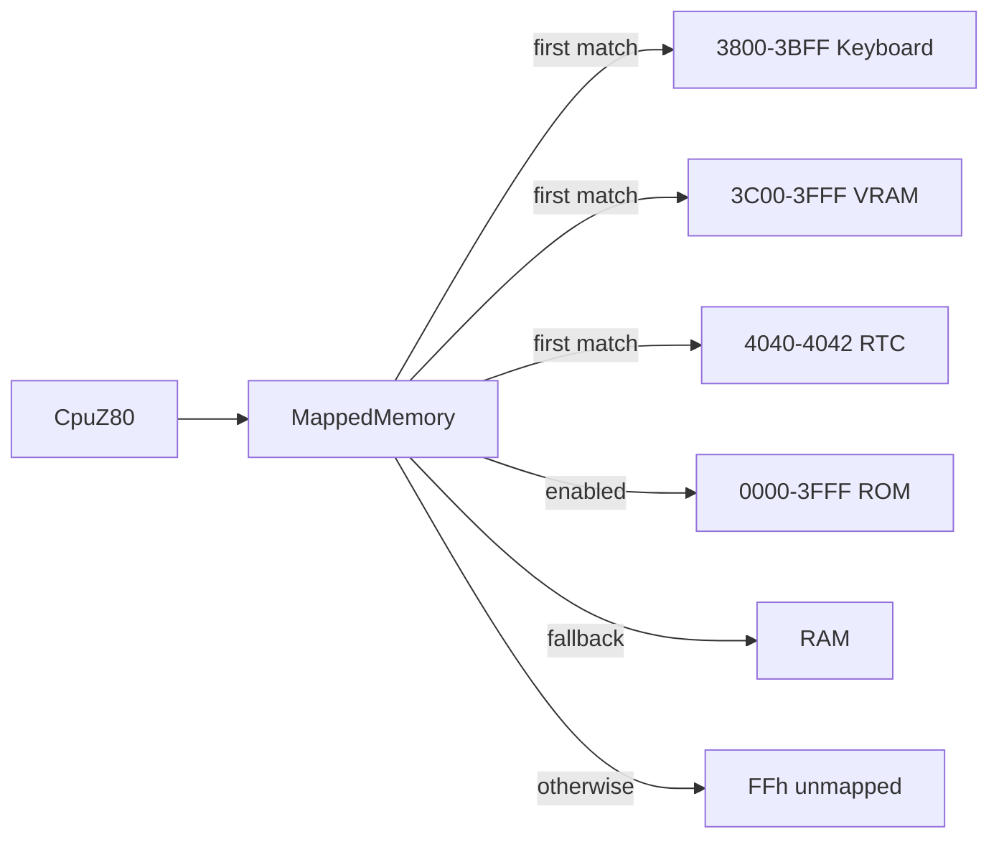

# CP-500 Mapped Memory

`MappedMemory` in Core dispatches the first matching `IMemoryRegion`, so region
order is hardware priority. `Cp500Machine` puts keyboard, video, and RTC ahead
of ROM and RAM, with an `UnmappedMemoryRegion` as its final deterministic
open-bus fallback. This is separate from the legacy banked `Memory` class,
which remains the CP/M-compatible implementation.

```csharp
var memory = new MappedMemory(
    keyboardRegion, // 3800h-3BFFh, active-high selected rows
    video.VideoRam, // 3C00h-3FFFh, events only on changed character cells
    rtc,            // 4040h-4042h, BCD seconds/minutes/hours
    rom,            // Cp500SystemRom, 0000h-3FFFh when enabled; writes are ignored
    ram,            // 4000h+ or full 64 KiB M80 underlay
    new UnmappedMemoryRegion(0, 65536));
```



## Contracts and invariants

- All regions fit one non-wrapping 64 KiB address range. `MappedMemory` returns
  `FFh` if no region responds, even when a caller omits a fallback region.
- `Cp500SystemRom` copies the image (padding to 16 KiB with FFh) and ignores
  writes. Its `Enabled` switch exposes lower-priority RAM only for a 64 KiB
  M80/M80C profile. Each read of F4h-F7h toggles `A11Forced`; while set, a ROM
  read at `a` returns EPROM byte `a | 0800h`, so 3000h-37FFh shows the
  monitor code at EPROM 3800h-3FFFh. Keyboard and video regions remain before
  ROM in the map, so they win in both A11 states. Reset clears `A11Forced`.
- `VideoRamRegion.Changed` fires after a value actually changes, avoiding
  redundant host redraws.
- `KeyboardMatrix` is 8-by-8 and active high (MAME `keyboard_r`). Address
  low-byte bits select rows; a pressed switch reads as a 1 bit and an idle row
  reads 00h. Selected rows are combined with bitwise OR, so a zero row mask
  reads 00h and multi-row selection reports every pressed key bit.
- Open bus writes are discarded and reads are predictably `FFh` by default.

## Rationale and lessons

The 16 KiB ROM socket overlaps the hardware keyboard/video addresses; priority
routing models that overlay directly. This supersedes the earlier planning
assumption of a fixed 12 KiB ROM range: the copied CP-500 ROM image is 16 KiB,
while the keyboard and VRAM still win at their physical addresses.

Related: [summary.md](summary.md), [devices.md](devices.md),
[../core/z80.md](../core/z80.md).
