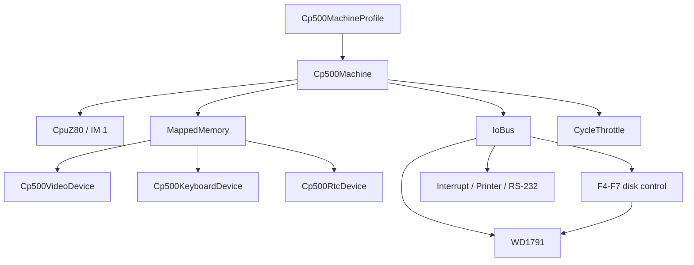

# CP-500 Core/Devices Machine

`Cp500Machine` is the UI-independent CP-500 / TRS-80 Model III composition in
`src/Heh8080.Devices`. It creates a `CpuZ80`, mapped memory, I/O bus, CP-500
devices, and an optional non-blocking cycle throttle from an immutable
`Cp500MachineProfile`. The existing `Emulator` and all CP/M device wiring stay
unchanged. The desktop host selects and runs this machine through
`MainViewModel`; those UI concerns remain outside the reusable composition.

```csharp
byte[] rom = File.ReadAllBytes(romPath); // User-owned, never embedded.
var machine = new Cp500Machine(Cp500MachineProfile.Original, rom);

machine.Video.CharacterChanged += (column, row, character) =>
    renderer.UpdateCell(column, row, character);
machine.Keyboard.SetKeyState(row: 0, column: 2, pressed: true);
int cycles = machine.Step();
await Task.Delay(machine.LastSuggestedDelay);
```



## Contracts and invariants

- A non-empty, user-supplied ROM is required. The machine copies at most the
  16 KiB ROM-socket image; it never reads files or embeds ROM data.
- The stock CP500-1 ROM performs an interactive boot sequence before BASIC:
  answer `Cass?` with Enter for the default 1500-baud cassette setting (or
  `L` for 500 baud), then enter the
  installed memory size at `Mem. usada ?` (`48` for the original 48 KiB
  profile) and press Enter. If left idle at real-time speed, this ROM repeats
  the cassette prompt and eventually advances to the memory prompt; this is
  firmware timeout behavior, not host keyboard input.
  The ROM may spend a noticeable interval testing RAM before displaying BASIC.
- The original and Turbo profiles install RAM from `4000h` upward. Only a
  64 KiB M80/M80C configuration has RAM under the ROM and may disable the
  overlay with `SetRomOverlay(false)`.
- Reset leaves RAM and disk images intact, restores ROM visibility, configures
  Z80 interrupt mode 1, and resets pacing, WD1791 state, and the F4h-F7h
  disk-control latch (with no drive selected).
- The keyboard is an active-low 8-by-8 matrix in the 3800h-3BFFh range.
  Released keys read as 1 bits, pressed keys clear their column bit, and
  selected rows are combined with bitwise OR. An idle or zero-row scan reads
  FFh. The stock ROM therefore remains at `Cass?` when the host keyboard is
  idle.
- `Step` does not sleep or block a UI/WASM thread. It returns a host-delay
  suggestion through `LastSuggestedDelay`; `StepAsync` is the opt-in scheduler
  helper.

## Rationale and lessons

Keeping the composition in Devices lets Desktop, Browser, tests, and a future
headless runner share exactly one CP-500 hardware contract. A host must call
`TickInterrupt()` at the profile's interrupt rate; timer ownership remains a
platform concern rather than a hidden background thread.

Related: [memory-map.md](memory-map.md), [devices.md](devices.md),
[desktop-integration.md](desktop-integration.md), [../core/z80.md](../core/z80.md),
[../devices/devices.md](../devices/devices.md).
