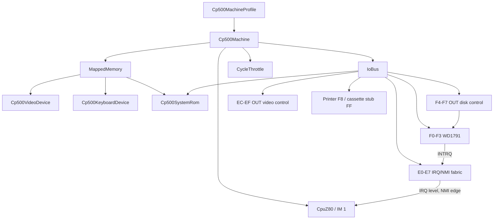

# CP-500 Core/Devices Machine

`Cp500Machine` is the UI-independent CP-500 / TRS-80 Model III composition in
`src/Heh8080.Devices`. It creates a `CpuZ80`, mapped memory, I/O bus and the
CP-500 devices from an immutable `Cp500MachineProfile`. The existing `Emulator`
and all CP/M device wiring stay unchanged. The desktop host selects and runs
this machine through `MainViewModel`; those UI concerns remain outside the
reusable composition.

```csharp
byte[] rom = File.ReadAllBytes(romPath); // User-owned, never embedded.
var machine = new Cp500Machine(Cp500MachineProfile.Original, rom);

machine.Video.CharacterChanged += (column, row, character) =>
    renderer.UpdateCell(column, row, character);
machine.Keyboard.SetKeyState(row: 0, column: 2, pressed: true);
int cycles = machine.Step();
await Task.Delay(machine.LastSuggestedDelay);
```



## Contracts and invariants

- A non-empty, user-supplied ROM is required. The machine copies at most the
  16 KiB ROM-socket image; it never reads files or embeds ROM data. The 2 KiB
  character generator is not part of the machine: it only matters to hosts that
  draw the screen (`Cp500CharacterGenerator`, `Cp500Raster`, see
  [devices.md](devices.md)).
- `Cp500MachineProfile` holds RAM (16, 32 or 48 KiB from `4000h`), the clock
  (2.03 MHz) and the installed disk drive count (0-4, default 2; zero is a
  cassette-only machine). Only the original 48 KiB, 2.03 MHz configuration is
  used by the desktop. Other Prologica revisions (M80, Turbo) are not modelled.
- The stock ROM (`cp500/cp500.rom`, CRC32 `c2fc1b92`, MAME's `cp500` dump)
  boots to a semigraphic logo with `PROLOGICA CP-500` and then depends on the
  disk drives, see "Boot flow" below.
- Reset leaves RAM and mounted disk images intact, restores ROM visibility,
  configures Z80 interrupt mode 1, and resets pacing, WD1791 state, interrupt
  latches, video control, the ROM A11 flip-flop, and the F4h-F7h latch (no
  drive selected).
- Every `IN F4h-F7h` toggles the A11 flip-flop inside `Cp500SystemRom`. While
  set, a ROM read at address `a` returns EPROM byte `a | 0800h`, so
  3000h-37FFh shows the monitor hidden behind keyboard and video at
  3800h-3FFFh. The ROM uses this at 3494h to copy the monitor to 4300h and run
  it, and toggles back at 47A4h. Keyboard and video keep priority.
  `OUT F4h-F7h` is the disk-control path. Full port table:
  [../devices/io-ports.md](../devices/io-ports.md).
- The keyboard is an active-high 8-by-8 matrix in the 3800h-3BFFh range.
  A pressed key reads as a 1 bit, idle rows read 00h, selected rows are
  combined with bitwise OR, and a zero row mask reads 00h.
- `Step` runs one instruction, advances the WD1791 deadlines and the 30 Hz
  timer by its cycle count, honors the disk WAIT line by letting hardware cycles
  pass without fetching, and sets `LastSuggestedDelay` for real-time pacing.
  It never sleeps or blocks a UI/WASM thread. Hardware time is derived only
  from executed cycles; the host owns no timer for it.
- `SpeedFactor` fast-forwards by pacing `LastSuggestedDelay` at a multiple of
  real time (`double.PositiveInfinity` never delays). The timer and disk scale
  with the CPU, so software sees normal hardware that finishes sooner. While a
  host key is held (`KeyboardMatrix.AnyPressed`, not the automatic BREAK) the
  machine paces at 1x: the ROM measures key holds and repeat in emulated time,
  so a fast-forwarded keypress auto-repeats. Each pace change restarts the
  `CycleThrottle` baseline, so there is no catch-up burst or stall. The factor
  survives `Reset`; change it only while `Step` is not running.
- Disk media is supplied through `IModelIIIDiskImageProvider`. A host that
  mounts files uses `Cp500DriveBay`, which adds names and the write-back
  policy: [devices.md](devices.md).

## Boot flow with the stock ROM

Observed with `cp500/cp500.rom` (real-ROM tests in `Cp500Tests.cs`; they skip
when the gitignored ROM is absent).

1. Drives installed and empty (default profile, nothing mounted): the ROM
   restores drive 0, sees TR00 (an installed drive reports track 0 whether or
   not it holds media), then waits for index pulses, which only a mounted disk
   produces. On timeout it prints `Diskette?` and retries forever. That loop
   never reads the keyboard, so BREAK pressed there is ignored. BREAK held
   from reset is different: the ROM samples it before the disk wait and goes
   to `BASIC (S ou N)?` (see `ResetHoldingBreak` below).
2. A mounted disk: five index pulses, then READ SECTOR 1 into `4300h` and a
   jump there. A disk without a boot loader (blank or unformatted) executes
   filler bytes and the machine is lost, which is the real hardware behavior.
   A disk whose boot sector runs code proceeds normally.
3. No installed drives (`installedDrives: 0`): no TR00, so the ROM falls to
   `BASIC (S ou N)?`. Answer `S`, Enter at `Cass?` (1500 baud default) and
   Enter at `Mem. usada ?` (a number there is a top-of-memory address, not a
   size). The ROM prints `PROLOGICA  1981  BASIC` and `READY`. A prompt that
   repeats by itself means phantom key presses, not a firmware timeout.

With drives, the ROM expects a bootable disk (TRS-DOS, DOS-500 and similar);
BASIC without one is reached by holding BREAK through reset or by a profile
without drives.

### Reset holding BREAK

`Cp500Machine.ResetHoldingBreak()` resets and then keeps BREAK (matrix row 6,
column 2) closed for `BreakHoldDuration` (1 s) of emulated time, long enough
for the ROM to sample it (it needs about 0.5 s). The countdown runs in `Step`
from executed cycles, so it is deterministic and uses no wall clock. The held
BREAK is a separate input (`Cp500KeyboardDevice.Automatic`) that the keyboard
region ORs with the host matrix, so releasing host keys (focus loss) never
drops it and a host key the user holds is never overwritten. A plain `Reset()`
cancels a pending hold. The desktop view model chooses it automatically on
CP-500 start and reset whenever drive 0 has no disk, see
[desktop-integration.md](desktop-integration.md). Tests: the machine-level
countdown tests and `RealRomWithEmptyDrivesResetHoldingBreakReachesBasic` in
`Cp500Tests.cs`.

## Rationale and lessons

Keeping the composition in Devices lets Desktop, Browser, tests,
`heh8080-cp500`, and the runner in [headless-runner.md](headless-runner.md)
share exactly one CP-500 hardware contract. Time is driven by
`Step`, so tests are deterministic and a host cannot drift the timer from the
CPU. Treating an installed drive as present even when empty is what makes the
ROM show `Diskette?` like the real machine instead of silently entering BASIC.

`heh8080-cp500` boots a caller-supplied ROM, types on the matrix, and waits
until `Cp500Screen.ToText` contains a snippet. The wait counts Z80 cycles at
2.03 MHz. Exit code 0 means the snippet appeared. A timeout is exit code 1.
A refusal is exit code 2. `--disk2` installs 3 drives
and `--disk3` installs 4. RAM stays 48 KiB. Flags, the codec, and the MCP
tool names are in [cp500-expansions.md](../plans/cp500-expansions.md) section 0.

Related: [memory-map.md](memory-map.md), [devices.md](devices.md),
[desktop-integration.md](desktop-integration.md), [../core/z80.md](../core/z80.md),
[../devices/devices.md](../devices/devices.md).
