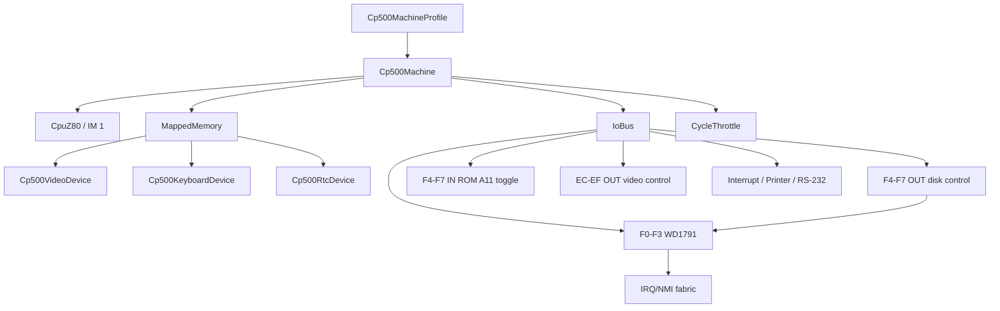

# CP-500 Core/Devices Machine

`Cp500Machine` is the UI-independent CP-500 / TRS-80 Model III composition in
`src/Heh8080.Devices`. It creates a `CpuZ80`, mapped memory, I/O bus, CP-500
devices, and an optional non-blocking cycle throttle from an immutable
`Cp500MachineProfile`. The existing `Emulator` and all CP/M device wiring stay
unchanged. The desktop host selects and runs this machine through
`MainViewModel`; those UI concerns remain outside the reusable composition.

```csharp
byte[] rom = File.ReadAllBytes(romPath); // User-owned, never embedded.
var machine = new Cp500Machine(Cp500MachineProfile.Original, rom);

machine.Video.CharacterChanged += (column, row, character) =>
    renderer.UpdateCell(column, row, character);
machine.Keyboard.SetKeyState(row: 0, column: 2, pressed: true);
int cycles = machine.Step();
await Task.Delay(machine.LastSuggestedDelay);
```



## Contracts and invariants

- A non-empty, user-supplied ROM is required. The machine copies at most the
  16 KiB ROM-socket image; it never reads files or embeds ROM data.
- The stock ROM (`cp500/cp500.rom`, CRC32 `c2fc1b92`, MAME's `cp500` dump)
  boots to a semigraphic logo with `PROLOGICA CP-500` and waits idle at
  `BASIC (S ou N)?`. Answer `S`, then Enter at `Cass?` (default 1500 baud, or
  `L` for 500 baud), then Enter at `Mem. usada ?` to use all memory (a number
  there is a top-of-memory address, not a size in KiB). The ROM prints
  `PROLOGICA  1981  BASIC` and `READY`. A prompt that repeats by itself means
  phantom key presses, not a firmware timeout.
- The original and Turbo profiles install RAM from `4000h` upward. Only a
  64 KiB M80/M80C configuration has RAM under the ROM and may disable the
  overlay with `SetRomOverlay(false)`.
- Reset leaves RAM and disk images intact, restores ROM visibility, configures
  Z80 interrupt mode 1, and resets pacing, WD1791 state, interrupt source
  latches, video control, the ROM A11 flip-flop, and the F4h-F7h
  disk-control latch (with no drive selected).
- Every `IN F4h-F7h` toggles the CP-500 A11 flip-flop (`Rom.A11Forced`).
  While set, a ROM read at address `a` returns EPROM byte `a | 0800h`, so
  3000h-37FFh shows the monitor hidden behind keyboard and video at
  3800h-3FFFh. The ROM uses this at 3494h to copy the monitor to 4300h and
  run it, and toggles back at 47A4h. Keyboard and video keep priority.
  `OUT F4h-F7h` is the disk-control path. Full port table:
  [../devices/io-ports.md](../devices/io-ports.md).
- The keyboard is an active-high 8-by-8 matrix in the 3800h-3BFFh range.
  A pressed key reads as a 1 bit, idle rows read 00h, selected rows are
  combined with bitwise OR, and a zero row mask reads 00h.
- `Step` does not sleep or block a UI/WASM thread. It advances WD1791 disk
  deadlines, honors the disk WAIT line by letting hardware cycles pass without
  fetching an instruction, and returns a host-delay suggestion through
  `LastSuggestedDelay`; `StepAsync` is the opt-in scheduler helper.
- Timer hardware is cycle-driven through `AdvanceCycles`; existing hosts may
  continue to call `TickInterrupt()` as the legacy 30 Hz heartbeat path.

## Rationale and lessons

Keeping the composition in Devices lets Desktop, Browser, tests, and a future
headless runner share exactly one CP-500 hardware contract. A host must call
`TickInterrupt()` at the profile's interrupt rate; timer ownership remains a
platform concern rather than a hidden background thread.

Related: [memory-map.md](memory-map.md), [devices.md](devices.md),
[desktop-integration.md](desktop-integration.md), [../core/z80.md](../core/z80.md),
[../devices/devices.md](../devices/devices.md).
