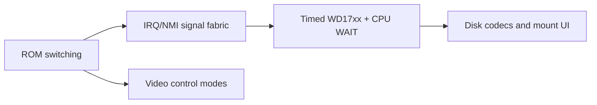

# CP-500 Model III Compatibility Remediation

This plan closes the high-priority gaps found by comparing the CP-500 machine
with MAME and SDLTRS Model III implementations. It preserves the CP/M machine,
keeps ROMs and disks user supplied, and explicitly excludes cassette transport,
audio, images, motor control, and cassette interrupts.



## Sequence and contracts

### 1. CP-500 F4h-F7h read-side ROM switching

- Separate the ROM/monitor bank control from the disk-control write latch.
  `IN F4h-F7h` must perform its hardware bank effect instead of returning only
  the last drive-control value.
- Model the A11 flip-flop explicitly. Keyboard and video regions must retain
  priority over both ROM views.
- No E0h-E7h aliases: those ports are the IRQ/NMI fabric, and F0h-F7h is the
  only disk path (see [../devices/io-ports.md](../devices/io-ports.md)).
- Test reset, every F4h-F7h read, drive/side writes, and execution from both
  ROM views.

Done: `Cp500SystemRom` owns the flip-flop. While `A11Forced`, a ROM read at
`a` returns EPROM byte `a | 0800h`.

```csharp
byte ignored = machine.IoBus.In(0xF4); // Forces A11; 3000h now reads EPROM 3800h.
Assert.True(machine.Rom.A11Forced);
```

**Exit criterion:** the supplied ROM reaches monitor and disk-boot paths without
host-side bank changes.

### 2. Model III interrupt, reset, and signal fabric

- Replace the heartbeat-only device with active-low masked IRQ sources at `E0h`
  and `E4h` FDC-INTRQ masking/status plus reset-NMI behavior.
- Keep cassette-source bits inactive and expose no cassette API.
- Present a CPU IRQ only when an enabled source transitions active. Add a
  Z80 NMI entry point if missing, preserving PC push and vector `0066h`.
- Generate the original 30 Hz timer from emulated-cycle deadlines. Keep host
  throttling separate from hardware time.
- Test acknowledge/mask behavior, simultaneous timer/FDC requests, reset-NMI,
  and inactive cassette bits.

**Exit criterion:** ROM and DOS handlers observe expected latch status, masks,
acknowledgements, IRQ, and NMI behavior.

### 3. Timed WD17xx with CPU WAIT

- Replace immediate sector completion with a cycle-driven controller: command
  delay, rotational arrival, DRQ byte windows, INTRQ completion, and motor
  timeout derive from emulated cycles.
- Implement restore, seek/step, read/write sector, force interrupt, read
  address, read track, and write track. Report busy, DRQ, not-ready,
  record-not-found, write-protect, CRC, and lost-data by command class.
- Add a Z80 wait line. When disk WAIT is requested, no instruction may fetch or
  retire until DRQ or INTRQ releases it; elapsed emulated time still advances.
- Route FDC INTRQ through the interrupt controller, never straight to the CPU.
- Test cycle boundaries, DRQ/INTRQ transitions, forced interruption, data-loss
  timeout, write protection, and WAIT release.

```csharp
while (machine.DiskControl.WaitActive)
    machine.AdvanceCycles(4); // Hardware time passes; the CPU does not execute.
```

**Exit criterion:** a disk ROM using WAIT and status polling boots a standard
CP-500/Model III DOS image without FDC shortcuts.

### 4. Native disk formats and host persistence

- Add JV1, JV3, and DMK parsers/serializers behind
  `IModelIIIDiskImageProvider`; retain raw 180/360 KiB images as an explicit
  simple format.
- Make sector metadata available to the FDC: track/side, ID, density,
  deleted-data marker, and CRC validity. Do not pre-flatten DMK/JV3 data.
- Add desktop mount/eject/save-as, then browser persistence after codec tests.
- Test valid fixtures, malformed-image rejection, round trips, and
  format-specific sector lookup.

**Exit criterion:** JV1, JV3, DMK, and raw images mount at native geometry and
boot through the same WD17xx path.

### 5. Model III video-control modes

- Add non-cassette video-control register `ECh`: 32/64-column selection and
  character-set/inverse behavior.
- Hold selected mode in `Cp500VideoDevice`; use CP500-2 glyphs when supplied,
  retaining a fallback renderer otherwise.
- Test register reads/writes, 32-column expansion, bit-7 graphics/inverse
  semantics, and mode changes without VRAM mutation.

**Exit criterion:** software changes the visible width or character set through
`ECh`; normal 64x16 BASIC output remains unchanged.

## Dependencies and delivery

Implement and merge in numeric order. Video work may proceed after phase 1,
but disk formats must wait for the timed FDC contract. Run targeted device tests
per phase, then CP/M regression tests and boot acceptance against user-supplied
DOS media.

Related: [cp500-emulation.md](cp500-emulation.md),
[../cp500/summary.md](../cp500/summary.md),
[../cp500/devices.md](../cp500/devices.md),
[../core/z80.md](../core/z80.md).
