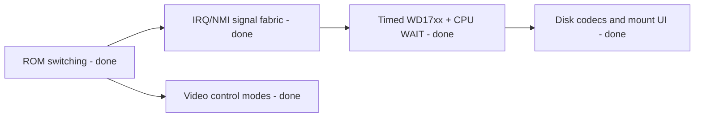

# CP-500 Model III Compatibility Remediation

This plan closed the high-priority gaps found by comparing the CP-500 machine
with MAME and SDLTRS Model III implementations. It preserves the CP/M machine,
keeps ROMs and disks user supplied, and excludes cassette transport, audio,
motor control, and cassette interrupts.

Status: steps 1-5 are **done**. Open follow-ups are listed at the end.



## Sequence and contracts

### 1. CP-500 F4h-F7h read-side ROM switching - done

- `Cp500SystemRom` owns an A11 flip-flop toggled by every `IN F4h-F7h`; while
  set, a ROM read at `a` returns EPROM byte `a | 0800h`. Keyboard and video keep
  priority. `OUT F4h-F7h` is the separate disk-control latch.
- No E0h-E7h aliases: those ports are the IRQ/NMI fabric, and F0h-F7h is the
  only disk path (see [../devices/io-ports.md](../devices/io-ports.md)).
- Tests cover reset, every F4h-F7h read, drive/side writes and execution from
  both ROM views.

**Exit criterion met:** the supplied ROM reaches the monitor and disk-boot paths
without host-side bank changes.

### 2. Model III interrupt and signal fabric - done

- `Cp500InterruptDevice` has active-low masked IRQ sources at `E0h`, FDC INTRQ
  masking/status at `E4h`, and acknowledge on `IN ECh`.
- The IRQ is a level into `CpuZ80.SetInterruptLine`; NMI is an edge into
  `NonMaskableInterrupt` (push PC, vector `0066h`).
- The 30 Hz timer comes from emulated-cycle deadlines (`AdvanceCycles`). Host
  throttling stays separate from hardware time.
- Cassette sources are not modelled and no cassette API exists.

**Exit criterion met:** ROM handlers observe the expected status, masks,
acknowledgement, IRQ and NMI behavior.

### 3. Timed WD17xx with CPU WAIT - done

- `Wd1791Controller` is cycle driven: command delay, DRQ byte windows, INTRQ,
  lost-data deadlines and a rotating index pulse. It implements restore,
  seek/step, read/write sector, force interrupt, read address, read track and
  write track, and reports busy, DRQ, not-ready, record-not-found,
  write-protect, CRC and lost-data by command class.
- `CpuZ80.WaitLine` stalls fetch while the latch holds WAIT; elapsed time
  still advances. FDC INTRQ goes through the interrupt controller.
- Installed drives: an installed drive reports TR00 without media; ready and
  index need media; uninstalled drives are never ready. This reproduces the
  ROM's `Diskette?` loop on empty drives.

```csharp
while (machine.DiskControl.WaitActive)
    machine.Step(); // Hardware time passes; the CPU does not execute.
```

**Exit criterion met for the firmware:** the real ROM finds a disk, reads the
boot sector with WAIT and status polling, and runs it
(`RealRomRunsTheBootSectorOfAnInsertedDiskette`). Booting a full TRS-DOS or
DOS-500 image is still to be run, see follow-ups.

### 4. Native disk formats and host persistence - done

- `ModelIIIDiskCodec` parses and serializes raw (180/360 KiB), JV3 and DMK
  behind `IModelIIIDiskImageProvider`. A JV1 file is byte-identical to a raw 180 KiB
  image, so it is the raw kind rather than a separate container.
- Sector metadata (track/side, ID, density, deleted-data marker, CRC validity)
  reaches the FDC without pre-flattening DMK/JV3 data.
- Desktop mount/unmount for drives 0-3 with write-back in the source format
  (`Cp500DriveBay`, `MainViewModel`, `ConfigDialog`); see
  [../cp500/desktop-integration.md](../cp500/desktop-integration.md).
- Tests cover valid fixtures, malformed-image rejection, round trips,
  format-specific lookup and the persistence policy.

### 5. Model III video-control modes - done

- `ECh` selects 32/64-column mode, the alternate character set and inverse
  fallback rendering in `Cp500VideoDevice`; mode changes never mutate VRAM.

## Follow-ups

- Browser disk mounting and IndexedDB persistence for CP-500 (the view model
  already takes bytes plus a write-back delegate, so Browser only needs storage).
- Boot a real TRS-DOS 1.3 / DOS-500 image to `DOS READY` (user-supplied media).
- CP500-2 glyph rendering, an ABNT layout, and the M80/Turbo revisions.

Related: [cp500-emulation.md](cp500-emulation.md),
[../cp500/summary.md](../cp500/summary.md),
[../cp500/devices.md](../cp500/devices.md),
[../core/z80.md](../core/z80.md).
