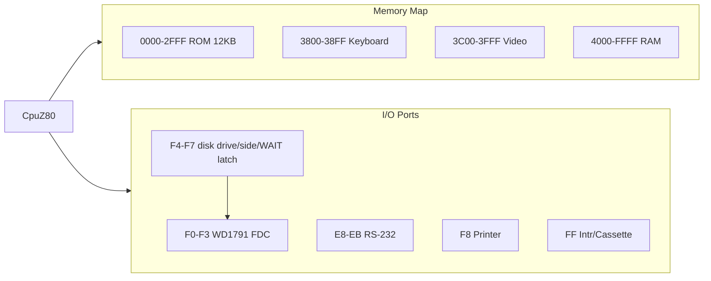

# CP500 (TRS-80 Model III) Emulation Plan

Goal: add a **Prológica CP-500** machine profile alongside the existing CP/M profile.
The CP-500 is a Brazilian TRS-80 Model III clone, so the target is Model III hardware
compatibility with CP-500-specific keyboard/ROM details layered on top.

Status: **Core/Devices foundation and desktop ROM bring-up implemented**. The
desktop app has CP/M-default profile selection, local ROM discovery, 64x16
rendering, host key mapping, and a paced Z80/30 Hz heartbeat loop. The next
work is CP-500 ROM switching, Model III interrupt/FDC semantics, disk codecs,
and video control modes. Cassette emulation is explicitly out of scope.

## Why this is feasible

- `CpuZ80` is complete (ZEXALL-validated) — the CP500 CPU (Z80 @ 2.03 MHz) needs no new opcodes.
- `Memory`/`IoBus` are plain 64 KB / 256-port buses — no CP/M assumptions in Core.
- All CP/M-ism lives in `Heh8080.Devices` port handlers and in `MainViewModel` wiring,
  so a parallel "machine" can coexist without touching LOLOS support.

See [../core/z80.md](../core/z80.md), [../devices/devices.md](../devices/devices.md).

## Hardware to emulate (Model III / CP-500)

| Component | Model III spec | Notes |
|-----------|----------------|-------|
| CPU | Z80 @ 2.03 MHz | Have it; needs cycle-accurate throttling (new) |
| ROM | 16 KB socket at `0000–3FFF` | User-supplied CP500 ROM dump; keyboard/video ranges overlay it; never bundle |
| RAM | 16/32/48 KB at `4000+` | Configurable; `3000–3BFF` is dead space |
| Video RAM | `3C00–3FFF`, 64×16 chars | Memory-mapped; replaces terminal byte-stream |
| Keyboard | Matrix at `3800–3BFF` | 8 active-high rows (pressed = 1, idle = 00h), low-byte select mask, ABNT layout planned |
| FDC | WD1791 at `F0–F3`; control at `F4–F7` | Default 40-track SS 18×256 (180 KiB); explicit DS option is 360 KiB |
| Cassette | 500/1500 baud, port `FF` bit | Explicitly unsupported; cassette-only signals remain inactive |
| Printer | Port `F8` | Map to existing `IPrinterDevice` |
| RS-232 | Ports `E8–EB` | Optional / stub; CP532C adapter on real hw |
| Interrupts | IM 1 timer 30/80 Hz; IRQ mask/status `E0-E3`, NMI `E4-E7`, timer ack `IN EC-EF` | See [../devices/io-ports.md](../devices/io-ports.md) |

## CP-500 revisions (per pt.wikipedia.org/wiki/CP_500)

| Model | Year | Differences |
|-------|------|-------------|
| CP-500 | 1982 | Base Model III clone, 0–2 full-height 178 KiB drives, cassette |
| CP-500/M80 | 1985 | Graphite case; **SO-08 OS (CP/M clone)**, up to **64 KiB RAM** |
| CP-500/M80C | 1986 | Slim drives, **cassette port removed** |
| CP-500/Turbo | 1987 | **4 MHz clock** |

Implications:
- **SO-08 mode**: full 64 KiB RAM with switchable ROM overlay (boot ROM, then all-RAM
  for CP/M). Model III's fixed `0000–2FFF` ROM map is insufficient — the mapped-memory
  regions from Phase 2 must support a runtime bank toggle.
- **Turbo**: just a throttle parameter (2.03 ↔ 4 MHz).
- **Cassette is lowest priority**: later hardware omitted it; v1 can be disk-only.



## Verified ROM dumps (in repo `cp500/`, git-ignored — never commit)

- `cp500.rom` — 16 KB system ROM (EPROM 27128), mapped at `0000–3FFF`.
  - Reset: `F3 AF C3 15 30` (DI, XOR A, JP 3015h); RST vectors jump to RAM hooks `4000h+`.
  - Contains: "PROLOGICA 1981 BASIC", "Mem. usada", "Diskette?", "Cass?", BASIC keyword
    and error tables, "Erro ... na", "READY".
  - **Built-in monitor**: "MONITOR VERSAO 1.1 1982", "PROLOGICA CP-500", register-dump UI
    (AF BC DE HL AF'… IX IY PC SP) — great for emulator bring-up debugging.
- `CP500-2.BIN` — 2 KB character generator: 256 glyphs × 8 bytes (8×8 px), includes
  Portuguese accented glyphs. (leiame.txt says 2732/4K; actual dump is 2K — upper half
  of EPROM unused.)

## Key architecture gap

`Memory` is a flat array; CP500 needs **region-dispatch** (ROM write-protect, VRAM
dirty-tracking, keyboard reads). Plan: add an `IMemory`-compatible mapped memory in Core
(e.g. `MappedMemory` with `IMemoryRegion[]`), keep existing `Memory` untouched for CP/M.
`ICpu` only needs `IMemory`, so `CpuZ80` works unchanged.

```csharp
public interface IMemoryRegion
{
    bool Handles(ushort address);
    byte Read(ushort address);
    void Write(ushort address, byte value);
}
// Regions: RomRegion, RamRegion, VideoRamRegion (raises VramChanged),
// KeyboardMatrixRegion, UnmappedRegion (returns 0xFF-ish garbage)
```

## Phases

### Phase 1 — Machine abstraction (no CP500 code yet)
- Introduce `MachineProfile` concept in App: `CpmProfile` (today's wiring) vs future `Cp500Profile`.
- Extract device wiring from `MainViewModel` into a `CpmMachine` builder so CP/M stays regression-free.
- Deliverable: app boots LOLOS exactly as before; tests stay green.

### Phase 2 — CP500 core machine (Core/Devices foundation complete)
- `MappedMemory` + ROM/RAM/VRAM/keyboard/unmapped regions are implemented in Core.
- `Cp500Machine` composes a Z80, copied user ROM image, configurable RAM, IM 1, and CP-500 devices without changing App wiring.
- `CycleThrottle` accumulates cycles and returns an asynchronous host delay; it never blocks desktop or WASM UI threads.
- Targeted tests cover ROM protection/overlay, VRAM events, keyboard matrix selection, and unmapped reads.

### Phase 3 — Video display (desktop host complete)
- `Cp500VideoDevice` exposes the 64×16 observable character plane.
- `RetroTerminalControl` switches between ADM-3A and CP-500 content while
  retaining the existing CRT shader and housing.
- Model III `@`-based text codes and 2×3 semigraphics are rendered.
- Exact CP500-2 character-generator glyphs remain optional future work and must
  also be user supplied.

### Phase 4 — Keyboard (desktop host complete)
- `Cp500KeyboardDevice` owns the active-high 8x8 matrix; idle rows read 00h
  and pressed columns set bits.
- Avalonia text and special keys map to Model III matrix positions; focus loss
  releases all keys.
- A configurable CP-500 ABNT-specific layout remains future polish.

### Phase 5 — Interrupts, RTC, misc ports (desktop heartbeat complete)
- Foundation complete: IM 1 reset configuration, a host-ticked 30/80 Hz timer IRQ (mask/status `E0`, acknowledge `IN EC`), BCD RTC at `4040-4042`, `F8h` printer adapter, RS-232 ready/data stub, and an `FFh` cassette stub.
- Desktop drives the original profile at 30 Hz from the paced background loop.
- Printer port `F8` → `IPrinterDevice`; RS-232 stubbed.
- Deliverable: `TIME$` advances; ROM keyboard auto-repeat works.

### Phase 6 — Floppy (WD1791)
- Foundation complete: `Wd1791Controller` is at `F0–F3`; `Cp500DiskControlDevice`
  mirrors the drive/side/WAIT latch at `F4–F7`. It implements restore,
  seek/step, read, write, and force-interrupt transfers over default 40-track
  single-sided 18×256-byte (180 KiB) media. Explicit double-sided media is
  360 KiB.
- The FDC exposes DRQ/INTRQ state/events; the latch exposes host-facing WAIT
  state without forcing CPU WAIT/NMI behavior into the reusable core.
- Disk image layer: DMK/JV1/JV3 readers mapping to existing `IDiskImageProvider`-style abstraction; extend browser IndexedDB storage.
- Deliverable: boot TRS-DOS 1.3 / DOS-500 disk image to `DOS READY`.

### Phase 7 — Disk host + polish
- Add host-owned disk image mount/save support, then browser IndexedDB persistence.
- Config dialog has CP/M ↔ CP500 selection. RAM/revision/charset controls and a
  general ROM picker are deferred; desktop discovers `cp500/cp500.rom`.
- Performance pass; browser WASM validation.
- Do not add cassette transport, audio, image formats, motor control, or cassette
  interrupts.

## High-priority compatibility work

The implementation order, device contracts, test boundaries, and explicit
cassette exclusion are defined in
[cp500-compatibility-remediation.md](cp500-compatibility-remediation.md).

## Testing strategy

- Unit tests per device in `tests/Heh8080.Tests` (new `Cp500*` fixtures).
- Golden-screen tests: hash rendered VRAM frames for known boot states.
- Keep the existing CP/M tests green — Phase 1 refactor is the risk point.
- Real-software acceptance: LEVEL II-style BASIC programs, TRS-DOS 1.3, one game.

## Current product choices

1. Desktop targets the original 1982 48 KiB CP-500 at 2.03 MHz.
2. CP/M remains the default profile and can be selected again at runtime.
3. ROMs remain user supplied; `cp500.rom` is loaded from `cp500/`.
4. Cassette is deferred; later models removed it and disk/ROM bring-up has priority.

## Legal note

ROM images and DOS disks are copyrighted; the app must load user-supplied files only.
Document where users can dump/legitimately obtain them; never embed in resources.

## Related lodes

- [emulator-implementation.md](emulator-implementation.md) — original 8-phase CP/M plan (complete)
- [../core/z80.md](../core/z80.md), [../devices/io-ports.md](../devices/io-ports.md)
- [../ui/desktop-app.md](../ui/desktop-app.md) — wiring that Phase 1 refactors
